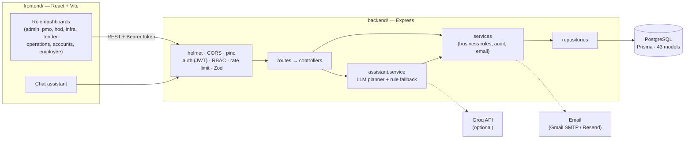

# HighwayOps Hub

**An operations platform for a civil-engineering consultancy that prepares Detailed Project Reports (DPRs) for highway projects.** It replaces spreadsheet-and-message tracking with one system for project tasks and field reports, project finance and RA bills, expenses, assets, tenders, contracts and HR-style workflows — each behind its own role.

Built and maintained by [Afzal Surti](https://github.com/AfzalSurti) as the in-house developer at Geo Designs & Research Pvt. Ltd.

`TypeScript` · `Node.js` · `Express` · `Prisma` · `PostgreSQL` · `React` · `Vite` · `TanStack Query` · `Tailwind` / `shadcn/ui`

---

## At a glance

| | |
|---|---|
| **Backend** | Express API, ~180 route handlers across 21 routers, layered as routes → controllers → services → repositories, with Zod validators per module |
| **Data model** | 43 Prisma models on PostgreSQL |
| **Auth** | Short-lived JWT access tokens + refresh tokens stored as hashes and revocable on logout |
| **Access control** | 8 roles — `ADMIN`, `PMO`, `HOD`, `INFRA`, `TENDER`, `OPERATIONS`, `ACCOUNTS`, `EMPLOYEE` — enforced by middleware on the API and by route guards in the UI |
| **Hardening** | Helmet, auth rate limiting, centralised error handling, request logging with pino, audit log table |
| **AI** | In-app assistant that turns chat messages into validated actions (Groq LLM planner with a rule-based fallback) |

## Modules

- **Projects & tasks** — projects, assignments, task lifecycle, report templates, daily field reports with attachments and comments, notifications, overdue tracking.
- **Project finance** — financial plans, professional fees, RA bills, carry-forwards, project billing entries, PDF exports.
- **Expenses** — expense sheets, vouchers, categories and an approval flow.
- **Assets** — asset register, class/type catalogue, movements between projects, maintenance, sale details, Excel import.
- **Tender & contracts** — tender bids, pre-contract and contract activities, letter numbering.
- **People** — team management, leave and overtime requests, hours calculation.
- **DPR overview** — project-level progress view for heads of department.

## The assistant

`POST /api/assistant/chat` (authenticated) accepts a chat message plus conversation history and returns one of three outcomes: `completed`, `needs_input` (with the missing fields listed) or `failed`.

1. **Plan.** If `GROQ_API` is set, an LLM (default `llama-3.3-70b-versatile`) maps the message to one action from a fixed list — e.g. `CREATE_PROJECT`, `CREATE_TASK`, `CREATE_EMPLOYEE`, `LIST_TASKS`, `PENDING_TASKS_MONTH`, `EMPLOYEE_PERFORMANCE`. Without a key, or if the call fails, a rule-based planner handles the same actions.
2. **Check.** Required arguments are validated; anything missing is asked for instead of guessed.
3. **Act.** The action runs through the same service layer the UI uses — the model never writes to the database directly.

Implementation: [`backend/src/services/assistant.service.ts`](backend/src/services/assistant.service.ts). Design notes: [`CHATBOT_IMPLEMENTATION.md`](CHATBOT_IMPLEMENTATION.md).

## Architecture



## Repository layout

```text
roadway-ops-hub/
├── backend/src/
│   ├── app.ts, server.ts      # Express wiring and entry point
│   ├── config/                # Zod-validated env, pino logger
│   ├── middleware/            # auth, rbac, rate-limit, validate, upload, error handling
│   ├── routes/                # 21 routers mounted under / and /api
│   ├── controllers/           # HTTP layer
│   ├── services/              # business logic (incl. assistant, audit, email)
│   ├── repositories/          # Prisma data access
│   ├── validators/            # Zod request schemas
│   ├── scripts/               # bootstrap and seed CLIs
│   └── utils/                 # jwt, password, pagination, financial-year, etc.
├── frontend/src/
│   ├── pages/                 # one folder per role + shared pages
│   ├── components/            # layout, sidebar, chat assistant, shadcn/ui primitives
│   └── lib/                   # API client, auth context, PDF generators
├── prisma/
│   ├── schema.prisma          # data model
│   ├── migrations/            # historical migrations (SQLite era — see limitations)
│   └── sql/                   # one-off SQL bootstrap scripts
├── showcase-site/             # separate marketing/demo site (own README)
├── docs/DEPLOYMENT.md         # Render + Vercel + Neon guide
└── render.yaml, vercel.json   # deployment configs
```

## Running locally

**Prerequisites:** Node.js 20+, a PostgreSQL database (local or Neon).

```bash
# 1. Install (also runs `prisma generate`)
npm install

# 2. Configure the backend — fill in DATABASE_URL and the two JWT secrets (min 16 chars)
cp .env.example .env

# 3. Configure the frontend
cp frontend/.env.example frontend/.env     # VITE_API_URL=http://localhost:4000

# 4. Create the schema (see "Known limitations" for why this is db push)
npx prisma db push

# 5. Create the first admin
npm run bootstrap:admin -- --email=<admin-email> --password=<strong-password> --name="Admin"

# 6. Start both apps (two terminals)
npm run dev             # API on http://localhost:4000  (health: GET /health)
npm run dev:frontend    # UI  on http://localhost:8080
```

On Windows, `.\run-project.ps1` frees the ports and starts both.

### Environment variables

| Variable | Required | Purpose |
|---|---|---|
| `DATABASE_URL` | yes | PostgreSQL connection string |
| `JWT_ACCESS_SECRET`, `JWT_REFRESH_SECRET` | yes | Token signing secrets (≥ 16 chars) |
| `JWT_ACCESS_EXPIRES_IN`, `JWT_REFRESH_EXPIRES_IN` | no | Defaults `15m` / `7d` |
| `CORS_ORIGIN` | no | Comma-separated allowed origins |
| `BCRYPT_SALT_ROUNDS` | no | 8–14, default 10 |
| `GROQ_API`, `GROQ_MODEL` | no | Enables the LLM planner for the assistant |
| `GMAIL` + `APP_PASSWORD`, or `RESEND_API_KEY` + `EMAIL_FROM` | no | Outgoing email |
| `APP_URL` | no | Public frontend URL used in emails |
| `VITE_API_URL` (in `frontend/.env`) | no | API base URL, default `http://localhost:4000` |

All values in `.env.example` are placeholders. Never commit a real `.env`.

## Scripts

| Command | What it does |
|---|---|
| `npm run dev` / `npm run dev:frontend` | Watch-mode API / Vite dev server |
| `npm run build` | Build frontend (`frontend/dist`) and backend (`backend/dist`) |
| `npm start` | Run the compiled API |
| `npm run lint` | ESLint |
| `npm test` | Vitest (frontend) |
| `npm run bootstrap:<admin\|administrative\|tender\|operations\|accounts>` | Create role accounts from CLI args |

## Deployment

Frontend on Vercel, API on Render, database on Neon — step-by-step in [`docs/DEPLOYMENT.md`](docs/DEPLOYMENT.md).

## Known limitations

- **Test coverage is minimal** — the Vitest suite has a single placeholder test; the service layer is the obvious next target.
- **No CI** yet.
- **Migrations are out of sync with the database provider.** `prisma/migrations/migration_lock.toml` still says `sqlite` from the project's early SQLite phase, while the schema now targets PostgreSQL, so `prisma migrate dev/deploy` fails (P3019). The schema is currently applied with `prisma db push`, and `render.yaml` runs `db push --accept-data-loss` on every start — risky for production data.
- Uploads go to the local `uploads/` directory, which is not persistent on ephemeral hosts.

## Roadmap

- Service-layer tests for finance and expense calculations, plus a CI workflow running lint, type-check and build.
- Move file uploads to object storage.
- Baseline a fresh PostgreSQL migration history (`prisma migrate diff` → `migrate resolve --applied`) and switch the Render start command to `prisma migrate deploy`.
